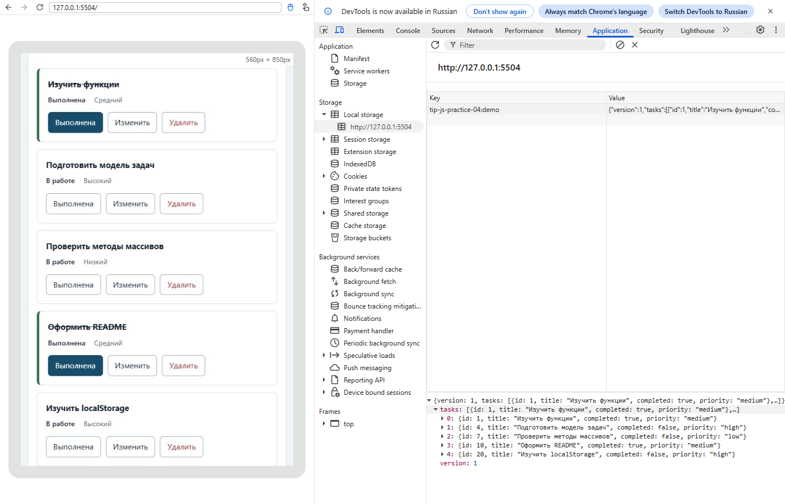

# Практическая работа 4 Формы валидация и локальное хранение

**Автор:** Сидлецкий Павел<br>
**Группа:** ЭФБО-06-25<br>
**Вариант:** 1<br>
**Дата проверки:** 11.11.2026<br>
**Среда:** Windows, Node.js v24.22.1, npm 11.19.1, Git 2.56.0.windows.3, Chromium 148.0.7778.96.


Реализованы создание и редактирование задач, два уровня валидации, сохранение и безопасное восстановление JSON. Модули data.js, task-service.js, task-selectors.js и task-view.js перенесены из собственной ПР3. Общий набор и шесть задач варианта сохранены. В сервис добавлен updateTask; карточка расширена кнопкой edit; main.js заполняет подготовленный каркас формы и обработчиков.

## Запуск

```powershell
cd practice-04
npm.cmd test
npm.cmd start
```

Зависимости не устанавливаются. Приложение: http://127.0.0.1:5504/, вариант: http://127.0.0.1:5504/?dataset=variant, проверки: http://127.0.0.1:5504/checks.html, лабораторный пример: http://127.0.0.1:5504/examples/forms-storage.html.

## Организация кода

task-service.js выполняет чистые операции модели; task-selectors.js отбирает отображаемые задачи; form-validation.js возвращает нормализованные значения или ошибки полей; task-storage.js проверяет схему, читает и записывает JSON; task-view.js строит безопасный DOM; main.js хранит состояние и связывает эти модули. renderApp ничего не сохраняет. Успешные add/update/toggle/delete сохраняются один раз через persistCurrentTasks.

Создание использует доступный id из FormData. При редактировании поле disabled и id берётся из editingId. completed сохраняется оператором spread исходной задачи. Неверный ввод не меняет массив и storage. Ошибки полей снимаются на input. После отмены фокус возвращается в id, после edit — в название; после toggle/delete — на действие либо текущий фильтр.

## Эксперименты формы и JSON

Прогноз по HTML/JSON: пустое required-поле остановит submit; пробелы пройдут required, но отклонятся после trim; FormData и localStorage дадут строки; повреждённый JSON вызовет исключение разбора. Эксперименты выполнены браузерной автоматизацией, отдельно от штатных проверок.

| Опыт | Ожидание | Фактический результат |
|---|---|---|
| Пустое required | submit не вызывается | submit=0, valid=False |
| Пробелы | Прикладной отказ | submit=1; Название не должно состоять только из пробелов. |
| FormData | Строковый title | string |
| localStorage | Строка JSON | string; {"title":"Нормальное название","priority":"low"} |
| Повреждённый JSON | Исходные задачи и предупреждение | Не удалось прочитать localStorage: Expected property name or '}' in JSON at position 1 (line 1 column 2) |

## Общий сценарий

Ожидание: 4 → 5 → 5 → 5 → 5 → 4 → 4 → 4 задачи; прогресс 50 → 40 → 40 → 40 → 60 → 50 → 50 → 50 процентов. Фактические данные:

| Шаг | id | Всего | Выполнено | Осталось | Прогресс | Запись |
|---|---|---|---|---|---|---|
| reset | [1, 4, 7, 10] | 4 | 2 | 2 | 50.0% | отсутствует |
| add20 | [1, 4, 7, 10, 20] | 5 | 2 | 3 | 40.0% | JSON version 1 |
| duplicate4 | [1, 4, 7, 10, 20] | 5 | 2 | 3 | 40.0% | JSON version 1 |
| edit4 | [1, 4, 7, 10, 20] | 5 | 2 | 3 | 40.0% | JSON version 1 |
| toggle7 | [1, 4, 7, 10, 20] | 5 | 3 | 2 | 60.0% | JSON version 1 |
| delete1 | [4, 7, 10, 20] | 4 | 2 | 2 | 50.0% | JSON version 1 |
| reload | [4, 7, 10, 20] | 4 | 2 | 2 | 50.0% | JSON version 1 |
| resetAgain | [1, 4, 7, 10] | 4 | 2 | 2 | 50.0% | отсутствует |

Дубликат 4 отклонён; строка localStorage до и после попытки одинакова. Редактирование 4 сохранило completed=false. После перезагрузки восстановлены [4,7,10,20]; после сброса удалён только текущий ключ.

## Индивидуальный вариант

Исходная тематика — подготовка учебного проекта; id [11,23,37,41,58,64], все задачи не выполнены. Добавлена 75 «Подготовить демонстрацию проекта», medium; задача 23 изменена на «Уточнить план учебного проекта», high; задача 37 удалена. Ожидание после удаления: шесть задач, 0 выполненных, 0.0%.

| Этап | id | Всего | Выполнено | Прогресс |
|---|---|---|---|---|
| initial | [11, 23, 37, 41, 58, 64] | 6 | 0 | 0.0% |
| add75 | [11, 23, 37, 41, 58, 64, 75] | 7 | 0 | 0.0% |
| edit23 | [11, 23, 37, 41, 58, 64, 75] | 7 | 0 | 0.0% |
| delete37 | [11, 23, 41, 58, 64, 75] | 6 | 0 | 0.0% |
| reload | [11, 23, 41, 58, 64, 75] | 6 | 0 | 0.0% |
| reset | [11, 23, 37, 41, 58, 64] | 6 | 0 | 0.0% |

Общий набор после редактирования варианта остался [1,4,7,10]. Ключи tip-js-practice-04:demo и tip-js-practice-04:variant независимы; проверки используют :checks:demo/:checks:variant.

## Границы и собственные случаи

| Действие | Ожидание | Факт |
|---|---|---|
| Создать title длиной 100 | Успех | Создана пятая задача |
| Создать title длиной 101 | Отказ | Проверка модулей 09: отказ |
| Перезагрузить после add/edit/delete | Точное восстановление | [4,7,10,20] и прежние поля |
| Записать {broken-json | Fallback с предупреждением | [1,4,7,10], диагностическое сообщение |
| getItem/setItem/removeItem выбрасывают исключения | Управляемый отказ | Проверки 21/24/26: ok:false |
| Неверная версия, дубликаты, строковый completed | Отказ всего набора | Проверки 15/19/20 пройдены |

## Отладка

Значения зафиксированы через точки останова Debugger в [отладочном протоколе](protocols/debug.json). Проверена клавиатура: Tab к названию, Enter для создания, Space для статуса, Enter для редактирования и отмены с возвратом фокуса в id. Для воспроизведения: в DevTools Sources открыть src/main.js, поставить точки в handleFormSubmit перед validateTaskDraft и перед присваиванием currentTasks. Сырой черновик для КР2: {id:"20", title:"  Изучить localStorage  ", priority:"high"}; проверенный результат: {ok:true,value:{id:20,title:"Изучить localStorage",priority:"high"}}. addTask возвращает новый массив из пяти задач. Запись: JSON с version:1 и tasks. Для id="4" валидатор возвращает errors.id, сервис и запись не вызываются. Эти значения также доступны в [протоколе сценариев](protocols/scenarios.json).

Дополнительное задание не выполнялось. Реализована обязательная часть. Приложение использует нативные required/min/step/maxlength и независимую прикладную проверку; после JSON.parse отдельно проверяет схему, версию и уникальность id.

## Фактические протоколы

[Полный вывод Node.js](protocols/node.txt).

```text
Проверок пройдено: 35; не пройдено: 0.
Проверок пройдено: 27; не пройдено: 0.
```

[Полный браузерный протокол](protocols/browser.txt).

```text
Всего: 23. Пройдено: 23. Ошибок: 0.
```

## Ответы на контрольные вопросы

1. **Почему основную обработку формы следует связывать с `submit`, а не только с кликом?**<br>
   submit поддерживает кнопку и Enter; обработчик click покрывает только мышь на одной кнопке.

2. **Что отменяет `preventDefault` и прекращает ли он выполнение обработчика?**<br>
   preventDefault отменяет стандартную отправку и переход страницы. Выполнение JavaScript продолжается.

3. **Какие значения возвращает `FormData.get` для обычных полей?**<br>
   Обычные текстовые и числовые поля возвращают строки; отсутствующее поле возвращает null.

4. **Почему disabled-поле id отсутствует в `FormData` при редактировании?**<br>
   disabled-контролы исключаются из успешных элементов формы, поэтому используется сохранённый editingId.

5. **Какие правила проверяет HTML, а какие относятся к прикладной модели?**<br>
   HTML проверяет required/min/step/maxlength. Модель проверяет trim, уникальность id, приоритет и существование задачи.

6. **Почему `required` не отклоняет строку из пробелов?**<br>
   Пробелы образуют непустую строку; требуется trim и проверка её длины.

7. **Для чего нужны `setCustomValidity("")` и `reportValidity()`?**<br>
   Пустая custom validity снимает старую прикладную ошибку; reportValidity показывает актуальные ограничения.

8. **Почему `validateTaskDraft` не обращается к DOM?**<br>
   Чистая функция отделяет модель от интерфейса и проверяется в Node.js без браузера.

9. **Как одна форма различает создание и редактирование?**<br>
   editingId равен null при создании и id выбранной задачи при редактировании.

10. **Почему `updateTask` не должен сбрасывать `completed`?**<br>
   Редактирование текста и приоритета не означает изменение состояния выполнения.

11. **Что именно хранит `localStorage`: объекты или строки?**<br>
   Строки. Объекты преобразуются JSON.stringify и восстанавливаются JSON.parse.

12. **Чем отсутствие ключа отличается от повреждённой записи?**<br>
   Отсутствие ключа — штатный первый запуск; повреждённая запись — fallback с предупреждением.

13. **Почему успешный `JSON.parse` не гарантирует корректность модели?**<br>
   JSON подтверждает синтаксис, но не поля, их типы, уникальность id или версию.

14. **Для чего в JSON добавлено поле `version`?**<br>
   version обозначает схему и позволяет отклонить несовместимый формат.

15. **Почему при ошибке одной задачи отклоняется весь сохранённый список?**<br>
   Частичное чтение скрывало бы потерю данных и нарушало целостность набора.

16. **Зачем функции хранения получают `storage` аргументом?**<br>
   Для явных зависимостей и моделирования недоступного storage без глобального window.

17. **Что происходит при невозможности выполнить `setItem`?**<br>
   Сохранение возвращает ok:false; приложение оставляет изменения в памяти и показывает предупреждение.

18. **Почему `renderApp` не должен сохранять данные?**<br>
   Отрисовка должна быть без побочных записей: фильтр и повторный render не изменяют модель.

19. **Почему фильтр и режим редактирования не сохраняются?**<br>
   По заданию это временное состояние интерфейса; после загрузки открывается форма создания и фильтр Все.

20. **Почему общий и индивидуальный наборы используют разные ключи?**<br>
   Разные ключи изолируют два независимых набора.

21. **Почему автоматические проверки используют отдельный namespace?**<br>
   Чтобы автопроверки не перезаписывали рабочие данные пользователя.

22. **Чем `removeItem` безопаснее `clear` в этом приложении?**<br>
   removeItem удаляет только текущий набор; clear удалил бы все ключи origin.

23. **Почему смена порта меняет видимое хранилище?**<br>
   Порт входит в origin вместе со схемой и именем узла.

24. **Какие проверки остаются ручными после успешного автоматического прогона?**<br>
   Проверка понимания кода, доступности, реального клавиатурного поведения, сообщений браузера и своих сценариев.


## Вывод

Форма, модель и хранение разделены. Список восстанавливается между перезагрузками, повреждённые данные не ломают запуск, общий и индивидуальный наборы изолированы.

## Снимок реального запуска


