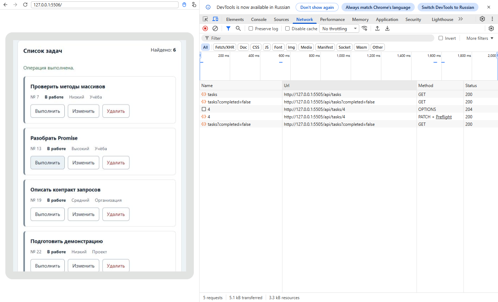

# Практическая работа 6 Браузерное приложение с API

**Автор:** Сидлецкий Павел<br>
**Группа:** ЭФБО-06-25<br>
**Вариант:** 1<br>
**Дата проверки:** 11.11.2026<br>
**Среда:** Windows, Node.js v24.22.1, npm 11.19.1, Git 2.56.0.windows.3, Chromium 148.0.7778.96.


Браузерный интерфейс подключён к API: загрузка, серверные фильтры, создание, редактирование, смена статуса, удаление, восстановление данных и повтор после ошибки. Источник задач — серверная память, localStorage не используется.

## Запуск

```powershell
cd practice-06
npm.cmd test
npm.cmd start
```

Приложение: http://127.0.0.1:5506/, API: http://127.0.0.1:5505/api, проверки: http://127.0.0.1:5506/checks.html, вариант: http://127.0.0.1:5506/?dataset=variant. ПР5 на порту 5505 нужно предварительно остановить. Для альтернативы: node tools/start.mjs 5515 5516 и http://127.0.0.1:5516/?api=http://127.0.0.1:5515/api.

## Реализация

api-client.js перенесён из ПР5 и расширен GET/POST/PATCH/DELETE. Тело сериализуется в JSON, Content-Type добавляется только с телом, body у GET запрещён. HTTP-ошибка проверяется раньше Content-Type; 204 возвращает null без JSON. Тайм-аут и внешний AbortSignal различаются.

task-api.js содержит getTasks/getTaskById/getCategories/loadInitialData/createTask/updateTask/setTaskCompleted/deleteTask/resetDemoData. Все задачи, категории и подтверждение reset проверяются до передачи контроллеру. POST передаёт title/priority/categoryId; id и начальный completed назначает сервер. PATCH статуса передаёт только completed.

form-validation.js нормализует title и числовой categoryId, проверяет название длиной 1–100, приоритет и существование категории. task-view.js создаёт li, название, статус, приоритет, категорию и три действия с textContent. dom-app.js связывает форму/кнопки и подтверждает удаление; main.js собирает зависимости.

app-controller.js не использует document. Сохраняет tasks/categories/filters/editingId. В начале загрузки показывает loading, после успеха ready либо empty, при сбое error с повтором. Если категории ещё не загружены, повтор снова вызывает loadInitialData. Ошибочная форма не обращается к API. Мутации блокируют действия и снимают блокировку в finally. После успешного POST/PATCH/DELETE/reset выполняется новый GET с текущими фильтрами.

Перед новой загрузкой предыдущий AbortController отменяется. Каждая загрузка получает sequence; результат может изменить UI только при совпадении номера. Это защищает и от ответов, которые уже завершились либо не реагируют на отмену. aborted не показывается как пользовательская ошибка.

## Индивидуальный вариант 1

Начальный запрос GET /api/tasks?completed=false возвращает [4,7,13,19,22,28,34], total=7. Задача 4 завершена PATCH /api/tasks/4 {completed:true}. Ожидание: новый GET с прежним фильтром исключает 4. Факт: [7,13,19,22,28,34], total=6. Для контрольной этот сценарий выполнен с тем же фильтром через форму. После reset снова семь исходных задач. В отдельной проверке варианта перед переключением существовала добавленная задача 35, поэтому там было восемь задач до действия и семь после — это зафиксировано в протоколе.

## Сценарные проверки

Сценарии выполнены автоматизацией настоящего Chromium с реальными локальными серверами; ожидаемые и полученные результаты проверялись отдельно. Задержка первого запроса использована как воспроизводимый аналог throttling.

| Сценарий | Ожидание | Факт |
|---|---|---|
| API остановлен | error | error |
| Повтор после запуска API | 12 | 12 |
| Пустой запрос | 0 | 0 |
| Невалидная форма без запроса | 0 | 0 |
| Создание и перезагрузка | 1 | 1 |
| Редактирование сохраняет completed | True | True |
| Отмена удаления | 1 | 1 |
| Быстрые фильтры с задержкой | [7, 22, 31] | [7, 22, 31] |
| Вариант 1 исходное количество | 8 | 8 |
| Вариант 1 завершённая задача исчезает | 0 | 0 |
| Reset восстанавливает вариант | 7 | 7 |
| Перезапуск API удаляет созданную задачу | 0 | 0 |


При остановленном API есть ошибка и кнопка повтора; после запуска повтор загружает категории и задачи. Созданная задача сохраняется при перезагрузке браузера. Перезапуск API возвращает исходный набор, поскольку сервер учебный и хранит данные только в памяти. Отмена подтверждения удаления оставляет задачу. Редактирование задачи 1 сохранило completed=true. Последний из двух быстрых фильтров определяет итоговую выборку [7,22,31].

В штатной браузерной проверке создания исправлен один дефект ожидания: requireNode бросал исключение на первом опросе до завершения POST; заменён на doc.querySelector внутри waitFor. Последующие проверки названия, id=35 и total=13 не изменены; ожидания сервера и остальные проверки сохранены. Серверные api/*.js/mjs не изменялись.

Дополнительное задание не выполнялось. Подробный [протокол сценариев](protocols/scenarios.json).

## Фактические протоколы

[Полный вывод Node.js](protocols/node.txt).

```text
Итог API: успешно 23, ошибок 0.
Итог модулей: успешно 33, ошибок 0.
Итог интеграции: успешно 14, ошибок 0.
```

[Полный браузерный протокол](protocols/browser.txt).

```text
Всего: 14. Пройдено: 14. Ошибок: 0.
```

## Ответы на контрольные вопросы

1. **Почему `fetch` обычно не отклоняет Promise при статусе 404 или 500?**<br>
   Получение 404/500 всё ещё является завершившимся HTTP-обменом. Клиент должен проверить response.ok.

2. **В каком порядке проверяются `response.ok`, статус 204, `Content-Type` и JSON?**<br>
   Сначала response.ok, затем 204, далее Content-Type успешного ответа и только потом JSON.

3. **Чем `POST` в контракте работы отличается от `PATCH`?**<br>
   POST создаёт новую задачу с назначенным сервером id; PATCH меняет переданные поля существующей.

4. **Для чего сервер возвращает 201 и заголовок `Location`?**<br>
   201 подтверждает создание ресурса; Location указывает адрес созданного ресурса.

5. **Почему у ответа 204 не вызывается `response.json()`?**<br>
   204 не содержит тела; JSON.parse пустого тела завершился бы ошибкой.

6. **Когда браузер отправляет CORS preflight и почему `no-cors` не решает задачу?**<br>
   Preflight предшествует междоменным PATCH/DELETE и JSON POST. no-cors не даёт читать нужный ответ и не разрешает PATCH.

7. **Чем `empty` отличается от `error` с точки зрения данных и интерфейса?**<br>
   empty означает успешный ответ с нулём задач; error — неуспешную загрузку с возможностью повтора.

8. **Почему `localStorage` больше не является источником задач?**<br>
   Источником истины стал API; localStorage не может заменить серверное подтверждение.

9. **Зачем повторно загружать список после успешной мутации?**<br>
   Повторный GET учитывает серверные правила и текущие фильтры, из которых изменённая задача может исчезнуть.

10. **Как возникает гонка двух запросов при быстрой смене фильтра?**<br>
   Первый медленный ответ может прийти после второго и затереть более новую выборку.

11. **Почему одного `AbortController` недостаточно для защиты от любого устаревшего результата?**<br>
   Операция может успеть завершиться или игнорировать сигнал; дополнительно проверяется номер загрузки.

12. **Почему отмена запроса не показывается пользователю как ошибка?**<br>
   При смене фильтра отмена является ожидаемым управлением потоком, а не сбоем пользователя.

13. **Что проверяет клиент, а что обязан повторно проверять сервер?**<br>
   Клиент проверяет поля для обратной связи; сервер независимо проверяет типы, допустимость полей и существование записей.

14. **Зачем контроллеру зависимость `view`, переданная параметром?**<br>
   Зависимость view позволяет проверять контроллер без document и менять представление независимо.

15. **Почему серверный текст выводится через `textContent`?**<br>
   textContent показывает данные текстом и не выполняет переданную HTML-разметку.


## Вывод

Интерфейс использует подтверждённое состояние API. Запросы разделены на транспорт, предметные операции и контроллер, а состояние загрузки и защита от гонок проверяются независимо от DOM.

## Снимок реального запуска


